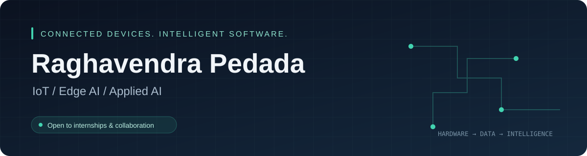

 

## Hi, I'm Raghavendra

I'm a **final-year B.Tech Computer Science and Engineering student** at **Alva's Institute of Engineering and Technology (VTU)**, specializing in **IoT, Cybersecurity and Blockchain** (graduating **2027**), and a **Software Intern at IFB Automotive**.

I work on two tracks: **IoT and embedded systems**, and **AI and software development**. My core strength is **edge AI**: models that run on the device, with no cloud dependency, so data stays private and systems keep working offline. I've shipped software on Windows desktop (C#/.NET), Android (Flutter), the web (React, FastAPI) and Raspberry Pi, with automated tests and CI/CD.

- **Currently:** Software Intern at IFB Automotive, and reproducing the [NeuEdge](https://arxiv.org/abs/2602.02439) spiking-neural-network paper in PyTorch.
- **Research:** co-author of an IEEE conference paper on the Edge-AI Smart Mirror, submitted to ICIPCN 2027 (under review).
- **Based in:** Bengaluru / Mangaluru, India.
- **Open to:** internships and collaboration in IoT, embedded systems, edge AI and software engineering.

## Selected projects

| Project | What it does | Core technologies |
| :--- | :--- | :--- |
| **[Edge-AI Smart Mirror](https://github.com/RaghavendraPedada-1765/Edge_AI_Smart_Mirror)** | Final-year project: a Raspberry Pi 4 mirror that detects mood (93% accuracy) and posture (89%) fully on the device, with under 50 ms inference and no internet. | Python · FastAPI · OpenCV · MediaPipe · TF Lite |
| **[PaisaPilot](https://github.com/RaghavendraPedada-1765/PaisaPilot)** | A UPI-first Android expense tracker for India. Reads bank SMS, Gmail card alerts and PDF statements on the phone; transactions never leave the device. | Dart · Flutter · SQLite (Drift) · Gmail API |
| **IFB Connect** *(private, built at IFB Automotive)* | An on-premises company messenger that runs entirely on the LAN: AD sign-in, chats and channels, presence, read receipts, verified file sharing and an admin console. | C# · .NET 8 · WinUI 3 · ASP.NET Core · SignalR |
| **[HashPilot](https://github.com/RaghavendraPedada-1765/HashPilot)** | Compares four hash-solving strategies, predicts a strategy with machine learning, and presents live telemetry and PDF reports. | Python · FastAPI · React · Random Forest · WebSockets |
| **[Cosmic RAG System](https://github.com/RaghavendraPedada-1765/Cosmic-RAG-System)** | Lets users upload PDFs and ask questions using local embeddings, vector search and an LLM. | Streamlit · LangChain · FAISS · Hugging Face · Groq |
| **[AI Resume Analyzer](https://github.com/RaghavendraPedada-1765/AI_ATS_Checker)** | Scores PDF and DOCX resumes against a job description on 5 weighted dimensions, with charts and JSON export. | Python · Streamlit · spaCy · Gemini · Groq |
| **[AQI IoT Station](https://github.com/RaghavendraPedada-1765/AQI-IoT-Station)** | Simulates environmental sensors and streams readings through MQTT to a Node-RED dashboard. No hardware required. | Python · MQTT · HiveMQ · Node-RED |
| **[Portfolio 2.0](https://github.com/RaghavendraPedada-1765/Portfolio_2.0)** | My cinematic 3D portfolio, live at [raghavendrapedada.dev](https://raghavendrapedada.dev). | JavaScript · Three.js · WebGL |

[Browse all repositories →](https://github.com/RaghavendraPedada-1765?tab=repositories)

## Tools I work with

**Languages**  
Python · C# · C · C++ · Java · JavaScript · TypeScript · Dart · SQL

**IoT & embedded systems**  
Raspberry Pi · ESP32 · Arduino · Sensors & GPIO · MQTT · Node-RED

**AI & data**  
TensorFlow Lite · PyTorch · MediaPipe · OpenCV · LangChain · FAISS · spaCy · Streamlit

**Applications & development**  
FastAPI · ASP.NET Core · SignalR · React · Flutter · WinUI 3 · SQL Server · SQLite

**DevOps & testing**  
Git · Docker · Kubernetes · OpenShift · GitHub Actions · Tekton · pytest · Playwright · Linux

## Experience & learning

- **IFB Automotive Private Limited, Bengaluru** — Software Intern (Sep 2026 – present). Built IFB Connect, the company's on-premises LAN messenger, and mapped the plant's end-to-end workflow.
- **Tata Consultancy Services** — Cybersecurity micro-internship (Mar 2025): identity and access management and enterprise security best practices.
- **IBM Applied DevOps Engineering Professional Certificate** — plus 17 more Coursera certificates from IBM, Google and DeepLearning.AI.
- **Cognizant Technoverse Hackathon 2026** — built “Invisible Patient”, a ward communication system for government hospitals.

## Let's connect

I'm interested in opportunities to build useful systems and learn alongside other engineers.

**[Portfolio](https://raghavendrapedada.dev)** · **[Connect on LinkedIn](https://www.linkedin.com/in/raghavendra-pedada-baa349356/)** · **[Email me](mailto:raghavendrapedadaa@gmail.com)**

Interested in connected devices, edge intelligence, or an AI project? Let's build something useful.
